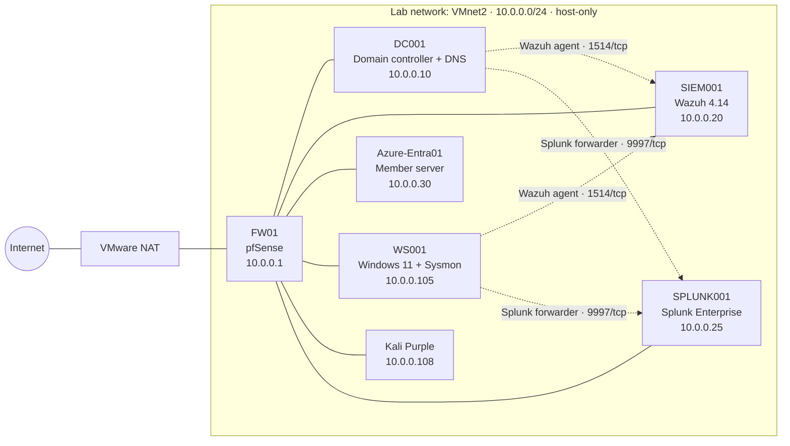

# Home SOC Lab: Active Directory + Wazuh + Splunk

A home Security Operations Center (SOC) lab built in VMware Workstation Pro to practice detection, log analysis, and alert triage. It has an isolated network behind a pfSense firewall, a Windows Active Directory domain, a Windows 11 endpoint with Sysmon, and two SIEMs: Wazuh, which collects and alerts on logs from every machine, and Splunk, used to search the same Windows events with SPL.

**Built:** October 2026 · **Author:** Daniel Deisrael · Cybersecurity & Information Assurance student, Western Governors University

## Skills demonstrated

- **Networking:** isolated lab network, pfSense firewall, DHCP, static IP planning, DNS forwarding and reverse zones
- **Active Directory:** domain setup, OUs and users, domain join, Group Policy, Advanced Audit Policy
- **Endpoint telemetry:** Sysmon with a community configuration, PowerShell script block logging
- **SIEM:** Wazuh all-in-one install, Windows agent deployment, custom log collection, real-time File Integrity Monitoring, threat hunting queries; Splunk Enterprise with Universal Forwarders and SPL searches (stats, eval, mvindex, table)
- **SOC analysis:** alert triage, Windows event IDs, SID interpretation, ticket writing
- **Troubleshooting:** 19 real problems diagnosed and fixed during the build (see [docs/troubleshooting.md](docs/troubleshooting.md))

## Network diagram

Also available as an image: [docs/network-diagram.png](docs/network-diagram.png)

## Virtual machines

| VM | OS / software | IP | Role | Sends logs to |
| --- | --- | --- | --- | --- |
| FW01 | pfSense CE | 10.0.0.1 (LAN), NAT (WAN) | Firewall, router, DHCP | Planned (syslog) |
| DC001 | Windows Server 2025 | 10.0.0.10 | Domain controller and DNS for `BuildBetter.digital` | Wazuh and Splunk: Security log with advanced auditing |
| SIEM001 | Ubuntu Server + Wazuh 4.14 | 10.0.0.20 | SIEM: indexer, server, dashboard | Server |
| SPLUNK001 | Ubuntu Server + Splunk Enterprise 10.6 | 10.0.0.25 | SIEM: receives forwarder data on 9997, search on 8000 | Server |
| Azure-Entra01 | Windows Server | 10.0.0.30 | Domain member server | Planned |
| WS001 | Windows 11 Enterprise | 10.0.0.105 (DHCP) | Domain workstation | Wazuh (Security, Sysmon, PowerShell) and Splunk (Security, System, Application, Sysmon) |
| Kali | Kali Purple | 10.0.0.108 (DHCP) | Outside machine on the lab network | No, by design |

The lab runs on one laptop with 32 GB RAM, usually 4 VMs at a time (FW01, DC001, WS001, plus either SIEM001 or SPLUNK001).

## Detections and tickets

| # | Alert | Level | Host | Verdict |
| --- | --- | --- | --- | --- |
| 1 | [Executable dropped in folder used by malware (92213)](tickets/01-edge-dll-in-temp.md) | 15 | WS001 | False positive: browser component update |
| 2 | [Domain Admins group changed (60159)](tickets/02-domain-admins-change.md) | 12 | DC001 | Authorized change (lab test), reverted |
| 3 | [User account locked out (60115)](tickets/03-account-lockout.md) | 9 | DC001 | Benign: lab test, account unlocked |
| 4 | [Sensitive file modified in Finance folder (550 / 554 / 553)](tickets/04-file-integrity-finance.md) | 7 | WS001 | Benign: lab test (FIM caught add, edit, and delete) |

## Build notes

- [Build notes, phase by phase](docs/build-notes.md)
- [Troubleshooting log](docs/troubleshooting.md)

## Screenshots

See [screenshots/](screenshots/README.md).

## Notes

- `BuildBetter.digital` is a lab-only domain name. The `.digital` ending is a real public top-level domain, which caused a DNS issue during the build (see the troubleshooting log). In production, use a domain your organization owns or a reserved name like `.internal`.
- No passwords, keys, or personal data are stored in this repository.
